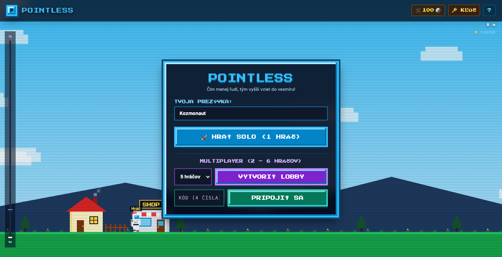
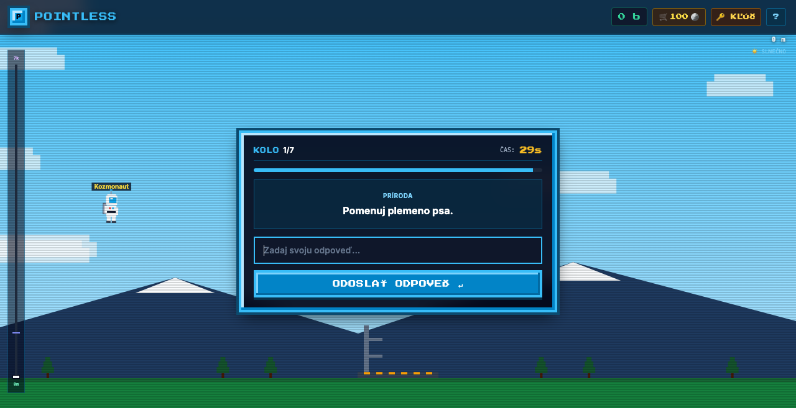
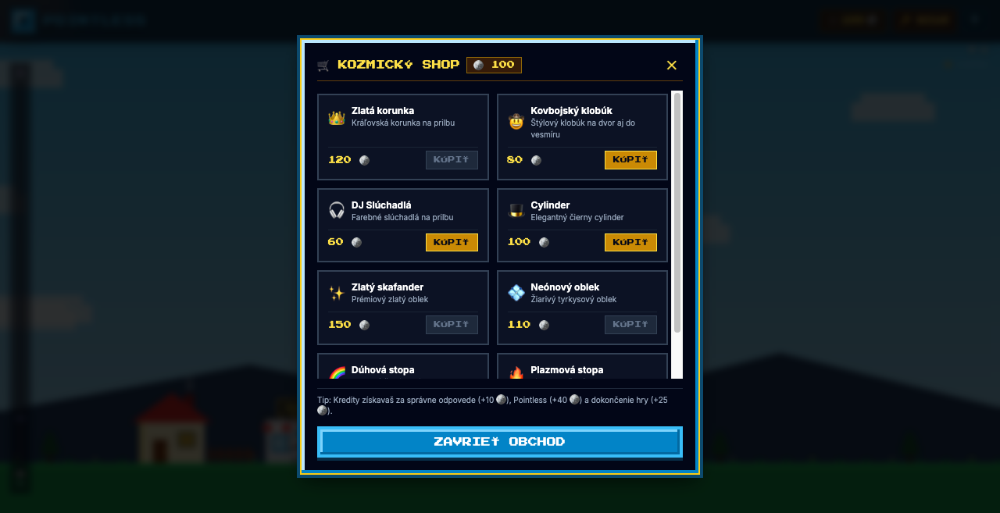

# 🚀 POINTLESS: Cesta do vesmíru

Retro pixel-artová vedomostná hra inšpirovaná televíznou súťažou **Pointless**, v ktorej sa svojimi odpoveďami snažíš vyletieť čo najvyššie do vesmíru. Hra podporuje **Solo** režim aj **Multiplayer pre 2 – 6 hráčov** priamo v prehliadači.

---

## 📸 Screenshoty

### Hlavné menu a výber režimu


### Priebeh hry (Solo / Multiplayer)


### Kozmický shop


---

## ✨ Hlavné funkcie

- **Princíp hry Pointless:** V každom zo **7 kôl** máš **30 sekúnd** na zadanie platnej odpovede na položenú otázku. Cieľom je vybrať takú správnu odpoveď, ktorú by v prieskume 100 ľudí povedalo **čo najmenej ľudí** (0 ľudí = **100 bodov**, teda *Pointless*).
- **AI vyhodnocovanie odpovedí:** Platnosť odpovedí a odhad počtu hlasov v prieskume vyhodnocuje **Google Gemini API**.
- **Vzlet do vesmíru:** Každý získaný bod posunie tvojho kozmonauta o **10 metrov** vyššie (maximum 700 bodov = 7 000 m). Na hranici **1 000 m** vstupuješ do vesmíru a po skončení 7. kola po teba priletí záchranná raketa.
- **Multiplayer (2 – 6 hráčov):** Hostiteľ vytvorí lobby a zdieľa **4-miestny kód miestnosti**. Ostatní hráči sa pripoja bez potreby zadávať vlastný API kľúč (komunikácia prebieha cez **PeerJS** / WebRTC, prípadne cez `BroadcastChannel` medzi kartami jedného prehliadača).
- **Kozmický shop:** Za správne odpovede (`+10 🪙`), Pointless odpovede (`+40 🪙`) a dokončenie hry (`+25 🪙`) získavaš kredity, za ktoré si môžeš kúpiť a nasadiť kozmetické doplnky pre svojho kozmonauta (pokrývky hlavy, skafandre a stopy jetpacku).
- **Dynamické pixel-artové prostredie:** Plátno s výškomerom, paralaxou a meniacim sa počasím (slnečno, dážď a búrka, sneženie, západ slnka).
- **Vlastná databáza otázok (`questions.txt`):** Otázky sú uložené v externom textovom súbore v jednoduchom formáte `KATEGÓRIA | Text otázky` (Geografia, Vesmír, Veda, História, Šport, Film & Seriály, Gaming, Príroda, Jedlo & Gastro, Hudba, Umenie a ďalšie).

---

## 🛠️ Ako hru spustiť

Keďže hra načítava otázky zo súboru [`questions.txt`](questions.txt) cez `fetch`, je potrebné spustiť ju cez lokálny HTTP server (nie priamo cez `file://`).

1. Naklonuj alebo stiahni tento repozitár a prejdi do jeho priečinka:
   ```bash
   cd "prva hra/test1"
   ```
2. Spusti lokálny server (napr. pomocou Pythonu):
   ```bash
   python3 -m http.server 8000
   ```
3. Otvor prehliadač na adrese:
   ```text
   http://localhost:8000
   ```
4. Pre **Solo** režim alebo **vytvorenie Multiplayer lobby** zadaj svoj bezplatný **Gemini API kľúč** z [Google AI Studio](https://aistudio.google.com/apikey) (ukladá sa iba lokálne v `localStorage` tvojho prehliadača). Hráči, ktorí sa iba pripájajú do existujúceho lobby, API kľúč nepotrebujú.

---

## 📁 Štruktúra projektu

- [`index.html`](index.html) – kompletná hra (HTML, Tailwind CSS cez CDN, pixel-art Canvas engine, herná logika, PeerJS multiplayer a Gemini API integrácia)
- [`questions.txt`](questions.txt) – zoznam otázok rozdelených podľa kategórií
- [`screenshots/`](screenshots/) – ukážky obrazoviek hry pre `README.md`
